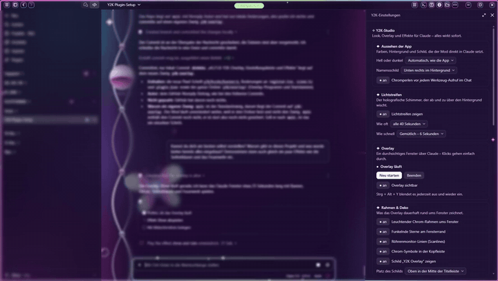
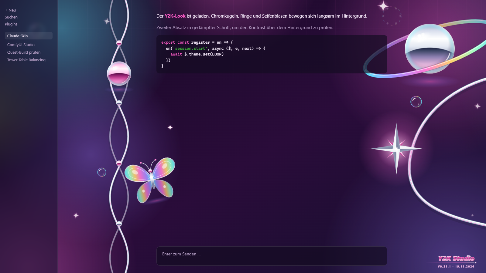
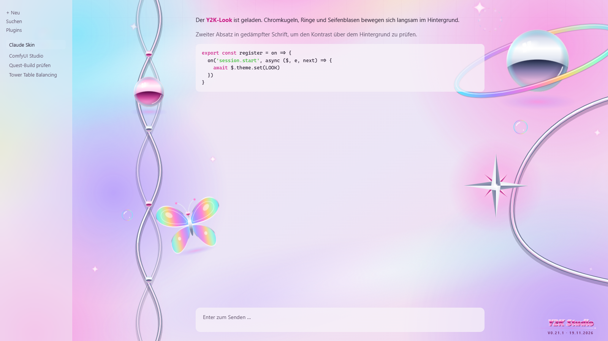

# ✧ Y2K-Studio für Claude

**Chrom, Perlmutt, irisierende Folie und Glitzer – die Jahrtausendwende-Ästhetik für die Claude-Desktop-App.**

Y2K-Studio besteht aus zwei Teilen:

1. **Ein Mod für Claude** (Claude Code, Code-Tab der Desktop-App): Farbschema, bewegter Hintergrund, Chromperlen an Werkzeug-Aufrufen, eine eigene Einstellungsleiste und der Befehl `/y2k`.
2. **Ein Overlay-Programm** (Windows und Mac): ein durchsichtiges Fenster, das sich an Claude andockt. Alle Klicks gehen hindurch – darüber leuchten Rahmen, Glitzer, Feuerwerk, Seifenblasen und Pixel-Banner, und es reagiert auf das, was in Claude passiert.

Claude arbeitet dabei ganz normal weiter; Y2K-Studio ändert nur, wie es aussieht.



▶ **[Demo-Video ansehen (30 s, MP4)](docs/demo.mp4)** – Banner, Seifenblasen, Feuerwerk und die Leiste „Y2K-Studio“ in der echten App. Chat und Seitenleiste sind absichtlich weichgezeichnet.

| Dunkel | Hell | Hintergrund in Bewegung |
|---|---|---|
|  |  |  |

---

## Was alles drin ist

### Im Mod (direkt in Claude)

- **Farbschema** für hell und dunkel: Hot Pink, Chrom-Silber, Cyber-Indigo – auch für Code, Links und Schalter. Automatisch wie die App, fest hell, fest dunkel oder aus.
- **Bewegter Hintergrund** hinter Milchglas: Chrom-Ringplanet, Doppelhelix mit Perlen, Pink-Kugel, Schmetterling, facettierter Stern mit Lens-Flare, aufsteigende Seifenblasen, Funkeln.
- **Lichtstreifen:** ein holografischer Schimmer, der über den Hintergrund wischt – an/aus, wie oft (alle 15 s bis alle 2 min), wie schnell (3 / 6 / 10 s).
- **Namensschild** aus Chrom mit eigenem Text, Version und Datum – unten rechts, scharf über dem Eingabefeld oder ausgeblendet.
- **Chromperlen** mit Zeichen vor jedem Werkzeug-Aufruf im Chat.
- **Leiste „Y2K-Studio“** mit allen Einstellungen in Karten – alles wirkt sofort, ohne Neuladen.
- **Befehl `/y2k`** für alles, was die Leiste kann.
- **Pixel-Banner als ASCII-Art:** eigener Text in einer selbst gezeichneten 5×7-Pixel-Schrift, als Blockzeichen-Banner (█▓▒░) in den Chat.

### Im Overlay (Windows)

- **Durchklickbar und angedockt:** liegt immer direkt über dem Claude-Fenster, wandert beim Verschieben mit, verschwindet beim Minimieren. Andere Programme liegen weiterhin darüber.
- **Rahmen & Deko:** leuchtender Chrom-Rahmen mit drehendem Farbverlauf, funkelnde Sterne am Rand, Röhrenmonitor-Scanlines, Schild „Y2K OVERLAY“ an wählbarem Platz.
- **Chrom-Symbole in der Kopfleiste:** Menü, Seitenleiste, Pfeile, Terminal, Dateien, Fensterknöpfe usw. bekommen eigene Chips mit Glanzlicht und Hover-Leuchten – die Knöpfe darunter funktionieren unverändert.
- **Reaktionen auf Claude** (über die Windows-Barrierefreiheit, UI Automation):
  - Das **Eingabefeld leuchtet** mit kreisendem Chrom-Ring, solange Claude arbeitet; ist die Antwort fertig, glitzert es dort.
  - **Status-Sterne an den Sitzungen** in der Seitenleiste: kreiselnd = läuft, pinker Punkt = ungelesene Antwort, gelb blinkend = wartet auf dich.
  - **Glitzer-Regen**, sobald eine Antwort fertig ist.
- **Effekte:**
  - ✺ **Feuerwerk** – Raketen mit Leuchtspur, Explosionen mit Schwerkraft und verglühenden Funken; auf Knopfdruck oder von selbst, Menge 10–400 %.
  - ○ **Seifenblasen** – schillernd, schwankend, platzen mit Ring; auf Knopfdruck oder von selbst, Menge 10–400 %.
  - ▦ **Pixel-Banner** – großer ANSI-Schriftzug mit Farbverlauf und Dither über der Chat-Mitte, für ein paar Sekunden oder dauerhaft.
- **Weiche Übergänge** beim Starten, Ein- und Ausblenden und Beenden; Steuerung aus der Leiste, per Befehl, über das ✧-Symbol im Infobereich oder mit **Strg + Alt + Y**.

### Mac

Der Mod läuft auf dem Mac unverändert. Das Overlay gibt es auch für den Mac (`y2k/overlay/mac/`, Swift) – mit allem, was die Windows-Fassung kann: Rahmen, Glitzer, Feuerwerk, Seifenblasen, Banner, Eingabefeld-Ring, Sitzungs-Sterne, Kopfleisten-Chips, Tastenkürzel **⌃⌥Y** und ein ✧-Menü in der Menüleiste.

- Voraussetzung: einmalig `xcode-select --install` (der Swift-Compiler). Beim ersten Start baut sich das Overlay selbst (`start.sh`, ca. 20–60 s).
- Für die Reaktionen auf Claude fragt macOS nach der Freigabe **Bedienungshilfen** (Systemeinstellungen → Datenschutz & Sicherheit). Ohne Freigabe laufen Rahmen und Effekte trotzdem.
- Jede Änderung wird [automatisch auf einem Mac gebaut und gestartet](../../actions/workflows/mac-overlay.yml). Mit der echten Claude-App auf dem Mac ist es noch nicht ausprobiert – Rückmeldungen sind sehr willkommen.

---

## Installieren

Voraussetzung: die **Claude-Desktop-App** mit Claude Code (Windows oder Mac). Für das Overlay unter Windows: Windows 10/11 mit dem eingebauten PowerShell 5.1 – sonst nichts.

In einem Terminal (PowerShell bzw. Mac-Terminal):

```powershell
claude plugin marketplace add friedensbringer-peacemaker/claude-y2k-studio
claude plugin install y2k@y2k-studio
```

Dann in der Claude-App eine neue Sitzung öffnen oder in einer laufenden `/reload-plugins` eingeben. Fertig – der Y2K-Look ist da.

**Oder als ZIP:** [neueste Version herunterladen](https://github.com/friedensbringer-peacemaker/claude-y2k-studio/releases/latest/download/claude-y2k-studio.zip), an einen festen Ort entpacken (der Ordner bleibt die Quelle) und dort:

```powershell
claude plugin marketplace add "C:\Pfad\zu\claude-y2k-studio"
claude plugin install y2k@y2k-studio
```

**Overlay starten:** `/y2k einstellungen` öffnet die Leiste → Karte „Overlay“ → **Starten**. Oder einfach `/y2k overlay`.

**Aktualisieren:**

```powershell
claude plugin marketplace update y2k-studio
claude plugin update y2k@y2k-studio
```

danach `/reload-plugins` und in der Leiste „Overlay → Neu starten“. Falls `/y2k` danach fehlt: `claude plugin list` prüfen und bei „disabled“ `claude plugin enable y2k@y2k-studio`.

**Ausschalten / entfernen:** zuerst `/y2k aus` (setzt Farbschema und Hintergrund zurück) und das Overlay beenden, dann `claude plugin uninstall y2k@y2k-studio`.

---

## Bedienung

### Die Leiste „Y2K-Studio“

Öffnen mit `/y2k einstellungen` (oder Rechtsklick im Chat → „✧ Y2K-Einstellungen“), schließen mit ✕ oben rechts oder `/y2k zu`. Die Leiste ist in vier Bereiche gegliedert:

| Bereich | Karte | Was man dort einstellt |
|---|---|---|
| **In Claude** | ◆ Aussehen der App | Hell oder dunkel, Namensschild, Chromperlen an Werkzeug-Aufrufen |
| | ◆ Lichtstreifen | an/aus, wie oft, wie schnell |
| **Overlay** | ◈ Overlay | Status, Starten / Neu starten / Beenden, sichtbar ja/nein |
| | ◈ Rahmen & Deko | Chrom-Rahmen, Sterne am Rand, Kopfleisten-Symbole, Scanlines, Schild und sein Platz |
| | ◈ Reaktionen | Eingabefeld-Leuchten, Status-Sterne, Glitzer-Regen bei fertiger Antwort |
| **Effekte** | ✺ Feuerwerk | Jetzt zünden, von selbst, wie oft, wie viel |
| | ○ Seifenblasen | Jetzt pusten, von selbst, wie viel |
| | ▦ Pixel-Banner | Text, Einblenden / Stehen lassen / Ausblenden, als ASCII-Art in die Eingabe |
| **Hilfe** | ⌘ Befehle | die Befehlsübersicht – ein- und ausklappbar, auch mit `/y2k hilfe` und `/y2k hilfe aus` |

### Befehle

| Befehl | Wirkung |
|---|---|
| `/y2k` | Übersicht aller Befehle |
| `/y2k hell` · `dunkel` · `auto` | Farbmodus festlegen |
| `/y2k aus` | zurück zum normalen Claude-Look |
| `/y2k einstellungen` / `/y2k zu` | Leiste öffnen / schließen |
| `/y2k hilfe` / `/y2k hilfe aus` | Befehlsübersicht in der Leiste ein- / ausblenden |
| `/y2k overlay` · `overlay neu` · `overlay aus` | Overlay starten, neu starten, beenden |
| `/y2k feuerwerk` | sofort eine Salve zünden |
| `/y2k seifenblasen` | sofort Blasen pusten |
| `/y2k feuerwerk an` · `aus` | Feuerwerk von selbst ein-/ausschalten (gleich für `seifenblasen`) |
| `/y2k feuerwerk mehr` · `weniger` | Menge um die Hälfte rauf oder runter |
| `/y2k seifenblasen 150%` · `normal` | Menge genau setzen (10–400 %) |
| `/y2k streifen an` · `aus` | Lichtstreifen zeigen oder ausblenden |
| `/y2k streifen schneller` · `langsamer` · `öfter` · `seltener` | Tempo und Häufigkeit |
| `/y2k banner Dein Text` | ASCII-Art-Banner in den Chat und groß über die Chat-Mitte (bis drei Zeilen à zwölf Zeichen) |

### Plugin-Einstellungen beim Installieren

```powershell
claude plugin install y2k@y2k-studio --config "label=Mein Text" --config schild=unten-rechts
```

| Einstellung | Standard | Wirkung |
|---|---|---|
| `label` | Y2K Studio | Text auf dem Chrom-Schild |
| `schild` | unten-rechts | `unten-rechts`, `ueber-eingabe` oder `aus` |
| `icons` | an | Chromperlen vor Werkzeug-Aufrufen |
| `overlay` | an | Glitzer-Puls ans Overlay, wenn eine Antwort fertig ist |

---

## Wie es funktioniert

- Der **Mod** nutzt die Mod-Schnittstelle von Claude Code: `$.theme.set` für Farben und die Hintergrund-Szene (reines SVG mit CSS-Animation), `ui.render` für die Leiste und die Chromperlen, `command.run` für `/y2k`, `turn.complete` für den Glitzer-Puls.
- Das **Overlay** ist ein eigenes Programm. Unter Windows ist es C# (Windows Forms), das PowerShell beim Start kompiliert – keine Installation, keine fremden Pakete. Es ist ein „besessenes“ Fenster des Claude-Fensters (liegt direkt darüber), durchsichtig pro Pixel und für Mausklicks durchlässig.
- Die **Anker** (Eingabefeld, Stopp-Knopf, Sitzungen, Kopfleiste) liest es über **UI Automation**, die Barrierefreiheits-Schnittstelle von Windows: Name und Lage der Bedienelemente, alle 0,6 Sekunden. Es liest **keine Inhalte** aus dem Chat und schickt nichts ins Netz.
- Mod und Overlay reden nur über kleine Dateien in `~/.claude/y2k-overlay/` (Einstellungen, eine Befehls-Warteschlange, ein Lebenszeichen). Details in [AGENTS.md](AGENTS.md).

**Bekannte Grenzen**

- Die Anker erkennen die Bedienelemente an ihren **deutschen Namen**. Läuft die App in einer anderen Sprache, bleiben Rahmen und Effekte, aber Eingabefeld-Ring, Sitzungs-Sterne und Kopfleisten-Symbole fehlen.
- Mods sind eine Early-Access-Schnittstelle von Claude Code und können sich mit App-Updates ändern.
- Das Mac-Overlay wird automatisch gebaut und gestartet, ist aber noch nicht mit der echten Claude-App auf einem Mac ausprobiert.

---

## Mitmachen und anpassen

Für Agenten und Entwickler: **[AGENTS.md](AGENTS.md)** beschreibt Aufbau, Dateiprotokoll, Bauen, Prüfen, Ausliefern, Rezepte für neue Effekte und alle Fallstricke, die beim Bauen aufgetaucht sind.

Kurz:

```powershell
claude plugin validate y2k                              # Mod prüfen
cd y2k; npx -y -p typescript@5.9.3 tsc -p . --noEmit    # Typen prüfen
python -I werkzeuge/render.py vorschau                  # Vorschaubilder ohne App (Windows: Python + Pillow, Node.js, Edge)
```

| Datei | Inhalt |
|---|---|
| `y2k/hooks/register.tsx` | Einstellungen, Leiste, Befehle, Overlay-Steuerung |
| `y2k/hooks/scene.ts` | der bewegte Hintergrund (SVG) |
| `y2k/hooks/banner.ts` | die Pixel-Schrift |
| `y2k/hooks/icons.ts` | die Chromperlen |
| `y2k/hooks/make-colors.js` | Hilfsdatei aus dem Claude-Code-Mod-Baukasten (Farbschema aus wenigen Farben) – nicht ändern |
| `y2k/overlay/Y2KOverlay.cs` | Overlay für Windows |
| `y2k/overlay/mac/` | Overlay für den Mac (Swift) und `start.sh` |

---

## Lizenz

[MIT](LICENSE). Inoffizielles Fan-Projekt, nicht von Anthropic.
